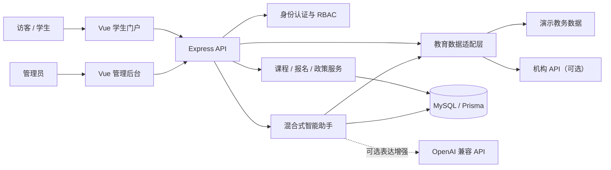
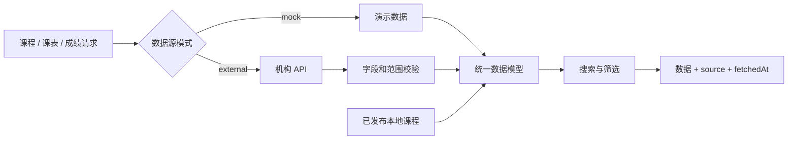
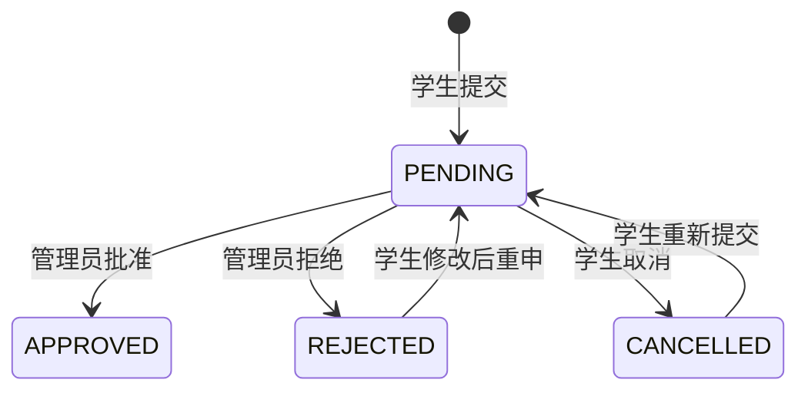

# OpenEdu 系统架构与论文设计说明

文档版本：2.0

适用范围：硕士论文项目支持与本地答辩演示

实现基线：2026-07-25

## 1. 研究问题与系统边界

教育机构通常同时维护课程内容、学生课表、成绩、报名信息和校内政策。数据来源分散、字段不统一，学生需要在多个入口之间切换，管理人员也难以控制不同岗位的操作范围。

OpenEdu 重点解决三个问题：

1. 如何以统一契约集成本地课程与机构教务数据。
2. 如何让智能问答基于可信数据和政策作答，而不是生成无法验证的信息。
3. 如何通过权限、状态流转和审计保证课程、政策和报名业务完整可追踪。

系统用于研究设计、原型实现和实验验证，不承担生产上线、高并发、支付结算或正式成绩管理。

## 2. 需求与取舍

### 2.1 核心功能

| 模块 | 核心能力 | 研究价值 |
|---|---|---|
| 多源数据集成 | 字段适配、来源标记、缓存、超时和格式校验 | 验证异构数据统一访问 |
| 智能教务问答 | 意图识别、可信上下文、政策检索、多轮追问 | 验证可解释问答方案 |
| 学生服务 | 登录、课表、成绩、收藏、提醒、报名 | 验证端到端学生流程 |
| 管理后台 | 课程、政策、报名、反馈、管理员管理 | 验证组织业务流程 |
| 权限与审计 | RBAC、状态保护、操作日志 | 验证治理与可追溯性 |

### 2.2 不纳入范围

- 在线支付与退款执行。
- 直播课堂与音视频会议。
- 社区论坛和即时通讯。
- 短信、邮件和商业推送。
- 原生移动应用。
- 单点登录、微服务拆分与分布式集群。
- 由聊天机器人直接修改成绩、排课或缴费。

这些能力会扩大项目范围，但不会直接增强当前论文要验证的数据集成和智能问答问题。

## 3. 用户与权限模型

### 3.1 用户身份

| 身份 | 可执行操作 |
|---|---|
| 访客 | 查看已发布课程，查询公开课程与政策，注册或登录 |
| 学生 | 访客能力，以及课表、成绩、收藏、提醒、报名、闪卡 |
| 超级管理员 | 全部管理能力、管理员账号和审计日志 |
| 内容管理员 | 课程维护、报名审核、反馈查看 |
| 政策编辑 | 政策维护，课程和反馈只读 |
| 数据分析员 | 课程、政策、报名和反馈只读 |

### 3.2 RBAC 权限矩阵

| 权限 | 超级管理员 | 内容管理员 | 政策编辑 | 数据分析员 |
|---|:---:|:---:|:---:|:---:|
| `course.read` | ✓ | ✓ | ✓ | ✓ |
| `course.write` | ✓ | ✓ |  |  |
| `policy.read` | ✓ | ✓ | ✓ | ✓ |
| `policy.write` | ✓ |  | ✓ |  |
| `feedback.read` | ✓ | ✓ | ✓ | ✓ |
| `enrollment.read` | ✓ | ✓ |  | ✓ |
| `enrollment.write` | ✓ | ✓ |  |  |
| `admin.manage` | ✓ |  |  |  |

前端路由用于减少无权限入口，后端中间件负责最终授权。系统不依赖前端隐藏按钮实现安全控制。

管理员保护规则：

- 禁止停用或降级最后一个有效超级管理员。
- 禁止管理员停用自身账号。
- 停用账号的旧令牌在后续请求中失效。
- 管理员与学生使用不同的 JWT 密钥和本地会话键。

## 4. 总体架构



### 4.1 前端

- Vue 3 Composition API 和 TypeScript。
- Vue Router 管理公开页、学生页和管理页。
- Pinia、组合式函数和统一 HTTP 层维护会话状态。
- vue-i18n 支持中文、英文和俄文。
- 全局悬浮助手可由首页和课程详情通过事件直接打开。

### 4.2 后端

- Express 5 提供统一 JSON API。
- Prisma 管理 MySQL 数据和迁移。
- 学生 JWT、管理员 JWT 与 RBAC 中间件相互独立。
- 请求编号、访问日志、速率限制、Helmet 和统一错误处理提供基础可观测性。
- `/api/legacy/*` 已停用并统一返回 `410 Gone`。

### 4.3 数据层

主要实体：

- `Student`：学生身份。
- `AdminUser`：管理员身份与角色。
- `Course`、`VideoResource`：本地课程和资源。
- `EnrollmentApplication`：报名申请及审核状态。
- `SchoolPolicy`：可发布、可版本化的政策知识。
- `CourseFavorite`、`LearningReminder`：学生学习服务。
- `StudyRecord`、`Flashcard`：学习过程数据。
- `ChatFeedback`：回答质量反馈。
- `AdminAuditLog`：关键管理操作日志。

## 5. 多源教育数据集成

### 5.1 统一数据入口

学生门户和智能助手都调用 `educationDataService`，避免为页面和问答分别维护两套数据逻辑。

数据源模式：

- `mock`：论文演示模式。
- `external`：机构接口模式。
- `Course` 表：管理员维护的本地课程。

公开课程目录由“已发布本地课程 + 当前机构课程源”组成。草稿课程不会进入门户或智能助手推荐结果。

### 5.2 适配流程



适配层当前实现：

- 外部请求超时。
- Bearer API Key。
- 数组或 `{ data: [...] }` 响应解包。
- 必填字段、空值、星期范围、成绩范围和出勤率校验。
- 公开机构课程 5 分钟内存缓存。
- 响应头返回数据来源和获取时间。
- 外部接口失败时返回明确的 `502/503`，不把演示数据伪装成真实结果。

## 6. 智能问答设计

### 6.1 当前能力边界

系统不是无限制闲聊机器人。当前核心是可解释的混合式问答：

```text
用户问题
  → 请求校验
  → 意图识别
  → 最近对话上下文解析
  → 权限判断
  → 结构化数据查询 / 政策检索 / 学习建议
  → 可选生成式表达增强
  → 回答 + 来源 + 建议追问 + 结构化卡片
```

生成式 AI 默认关闭。关闭时，可信数据类问题仍有确定性回答；开启时，模型不能脱离请求中提供的可信上下文编造事实。

### 6.2 意图集合

| 意图 | 数据与处理方式 |
|---|---|
| `TIMETABLE` | 登录身份对应的机构课表 |
| `GRADES` | 登录身份对应的成绩与出勤 |
| `COURSE_DISCOVERY` | 已发布本地课程与机构课程 |
| `STUDY_PLAN` | 可执行的学习计划模板 |
| `SCHOOL_POLICY` | 数据库中已发布政策 |
| `TRANSLATE` | 语言学习辅助；无 AI 时提供受控说明 |
| `GENERAL` | 能力导航和安全兜底 |

最近六轮对话用于处理“它”“这个课程”“继续”等指代。每条消息限制为 500 字。

### 6.3 回答多样性

回答多样性来自任务结构，而不是随机改写事实：

- 课表使用时间顺序。
- 成绩使用摘要与改进建议。
- 课程发现使用比较说明和课程卡片。
- 学习计划使用分日安排。
- 政策回答引用政策名称与版本。
- 每类意图返回不同的建议追问。
- 同时区分机构事实、演示数据、政策规定和学习建议。

### 6.4 安全策略

- 课表与成绩只读取 JWT 中的学生身份。
- 未登录用户不能查询个人数据。
- 政策仅检索已发布版本。
- 不保存完整问答正文；反馈仅保存回答编号、意图、评价和可选原因。
- AI 鉴权失败后进入临时冷却，避免每条消息重复等待无效配置。
- 不允许通过聊天直接修改高风险业务数据。

## 7. 业务状态与闭环

### 7.1 报名流程



学生可以查看当前状态和审核意见；管理员审核后记录审核人、审核时间并写入审计日志。

### 7.2 政策流程

```text
新建草稿 → 编辑关键词、摘要和指引 → 发布 → 进入助手知识库
                         ↘ 停用/删除 → 不再参与公开问答
```

每次修改更新版本号和时间。政策写权限与课程写权限相互独立。

### 7.3 课程流程

```text
管理员创建课程 → 添加资源 → 草稿检查 → 发布
                                      ↓
                         门户课程列表、详情和助手推荐
```

取消发布后，课程立即退出公开目录，但仍可在管理端查看和修改。

## 8. 主要 API 分区

| 前缀 | 用途 |
|---|---|
| `/api/register`、`/api/login`、`/api/me` | 学生认证 |
| `/api/gateway/*` | 统一教育数据查询 |
| `/api/chatbot*` | 意图识别、问答与反馈 |
| `/api/favorites`、`/api/reminders`、`/api/enrollments` | 学生业务 |
| `/api/courses` | 管理课程与资源 |
| `/api/admin/*` | 管理认证、账号、报名、政策与审计 |
| `/api/health`、`/api/ready` | 运行和数据库就绪检查 |

完整字段契约见 `INTEGRATION_API_CONTRACT.md`，运行说明见 `README.md`。

## 9. 非功能设计

### 9.1 可用性

- 所有异步操作应显示加载、成功或失败状态。
- 无权限、未登录、会话过期、空数据和接口异常都有可见反馈。
- 桌面端与 375px 宽度移动端均需通过核心流程检查。
- 首页和课程详情的智能助手按钮直接打开聊天窗口。

### 9.2 安全与隐私

- 密码使用哈希存储。
- 认证接口和问答接口分别限流。
- 后端对输入长度、类型和枚举范围进行校验。
- 管理操作保留最小必要的审计信息。
- 文档中的账号密码只用于本地演示。

### 9.3 可复现性

- Docker Compose 固定服务组成和端口。
- Prisma migration 保存数据库演进。
- 演示数据不依赖外部系统。
- 生成式 AI 可关闭，保证核心实验不依赖付费密钥。

## 10. 论文实验计划

### 10.1 待验证问题

1. 混合式问答是否比纯关键词方案具有更高的意图识别和任务完成率。
2. 增加政策检索与上下文后，来源正确率和多轮成功率是否提高。
3. 统一适配层在接口异常和字段变化时能否提供稳定、可解释的失败结果。

### 10.2 对比方案

| 方案 | 组成 |
|---|---|
| Baseline A | 单一关键词匹配 |
| Baseline B | 意图识别 + 结构化教育数据 |
| OpenEdu | 意图识别 + 数据集成 + 政策检索 + 对话上下文 |

### 10.3 指标

- Intent Accuracy。
- Macro Precision、Macro Recall、Macro-F1。
- 政策检索 Recall@K 与 MRR。
- 回答事实正确率。
- 数据来源标注正确率。
- 多轮任务成功率。
- 安全拒答率。
- 平均、P95 响应时间。
- 学生和管理员关键流程通过率。

评测数据必须独立于意图规则开发样例，保存固定版本，并支持自动生成结果文件。

## 11. 当前限制与后续顺序

当前限制：

- 尚未连接真实机构 API。
- 生成式 AI 默认关闭。
- 问答契约测试规模较小，尚不能作为论文统计结果。
- 部分学习进度为明确标识的演示操作。
- 尚需补齐端到端自动化和 API 异常契约测试。

后续实施顺序：

1. 建立独立问答评测集和指标脚本。
2. 增强外部 API 重试、缓存状态和失败统计。
3. 补充多身份与业务状态自动化测试。
4. 清理未使用的旧聊天组件和旧接口文件。
5. 根据实验结果生成论文表格、流程图和答辩演示脚本。
